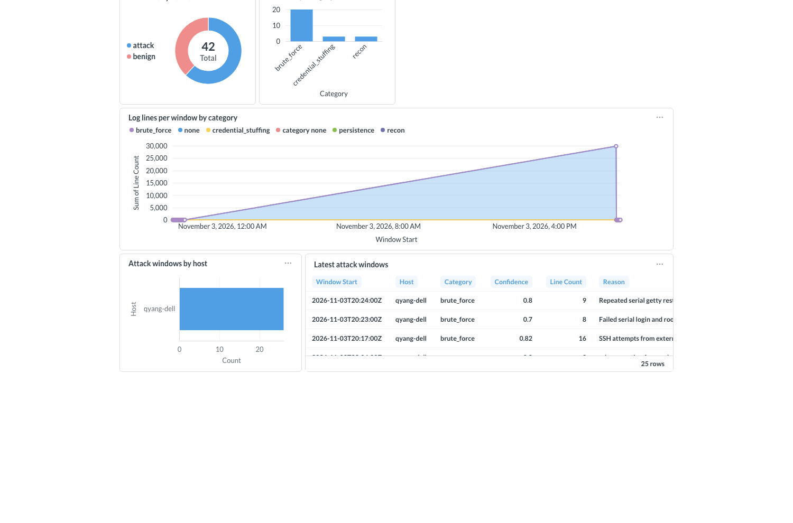

# Syslog intrusion detection: an off-the-shelf LLM called from Confluent Cloud Flink SQL

Stream Linux syslog into Kafka, group it into 1-minute windows per host, and let an LLM play SOC analyst: each window
gets a verdict (`attack` / `benign`), a category (`brute_force`, `recon`, ...), a confidence and a short reason. No
training: the intelligence is the system prompt in `CREATE MODEL`. Results land in a Kafka topic and a Metabase dashboard.



*The "Syslog IDS" Metabase dashboard on the `syslog_alerts` table: verdict mix, attack categories, log volume over time,
attacks by host and the latest attack windows with the model's reason.*

## How it works

```
syslog (Logstash) -> Kafka topic `syslog`  (schemaless JSON)
   -> Flink `syslog-windowing`: drop apparmor noise, 1-min tumbling window per host, >= 3 lines   -> table `syslog_windows`
   -> Flink `syslog-scoring`:   the model reads one window as a prompt, replies with a JSON verdict -> table `syslog_alerts`
   -> RTCE on `syslog_alerts` -> Metabase (Confluent Lightning JDBC) -> "Syslog IDS" dashboard
```

Per-minute windows catch rate-based attacks (brute force, scans) that single lines cannot show; the trade-off is up to
about a minute of latency. Every window is scored, attack and benign, so you can filter on `verdict` downstream.

## Two model backends

Pick one with the Terraform variable `slm_backend`:

| | `vllm` (default) | `managed` |
|---|---|---|
| Model | Qwen2.5-3B-Instruct on vLLM, EC2 g5.xlarge GPU behind CloudFront (https) | Confluent Cloud managed model (`managed_model`, default `anthropic.claude-sonnet-4-6`) |
| Flink call | `ML_PREDICT` via a `CREATE CONNECTION` (OpenAI-compatible endpoint) | `AI_COMPLETE`, model `provider = 'confluent'`, no connection |
| Needs | AWS account, GPU bills hourly | nothing outside Confluent Cloud, billed per token |
| Model input/output | `text` / `verdict` | `prompt` / `response` |

Both share the same system prompt. Managed model names vary by region (`SHOW MODELS` in Flink). The model name in Flink
is `syslog_analyst` in both modes, so run `DROP MODEL syslog_analyst` when you switch (`CREATE MODEL` is IF NOT EXISTS).
The managed backend is newer and less tested than vLLM.

## Deploy

All commands run from this folder. Confluent Cloud credentials come from `~/vault/ccloud/*.env` (author's sandbox,
see `CLAUDE.md`); override the Terraform defaults for another environment.

```bash
# 1. Terraform: Flink tables (and topics), RTCE on syslog_alerts, a Metabase service account + Global API key,
#    and the rendered SQL (terraform/generated/flink_syslog.sql).
#    managed backend (no AWS):
cd terraform && terraform apply -var slm_backend=managed
#    or: SLM_BACKEND=managed ./deploy_terraform.sh
#    vllm backend (starts a billing GPU, first boot ~10 min): ./deploy_terraform.sh   (needs ~/vault/aws/qyang1.env)

# 2. Flink: model + the two continuous INSERT statements (`syslog-windowing`, `syslog-scoring`)
./deploy_flink.sh

# 3. Source: ship syslog to the `syslog` topic (see logstash/README.md)

# 4. Dashboard (http://localhost:3001)
cd metabase && ./start.sh
```

The statements read the latest offset only, so results appear once new syslog arrives and a window closes (about 1 to 2
minutes). `metabase/README.md` covers the dashboard, the no-login public link and auto refresh (`#refresh=60`).

## Tear down

`./teardown.sh` stops and deletes the two Flink statements and destroys only the GPU instance and CloudFront (skipped
for the managed backend). It keeps the tables, RTCE, the Metabase key and the model. `--purge` also drops the model and
connection (which holds the vLLM key); `--all` also destroys everything else Terraform created (RTCE, service accounts,
API keys, so Metabase stops working) and drops the two tables.

## Layout

- `terraform/`: GPU + CloudFront (vllm only), Flink tables, RTCE, Metabase key, SQL template `flink_syslog.sql.tpl`
- `deploy_terraform.sh`, `deploy_flink.sh`, `teardown.sh`: lifecycle scripts
- `logstash/`: syslog to Kafka
- `metabase/`: dashboard, its own Metabase container and README
- `assets/`: screenshots

## Open items
- No labels yet: quality is judged by eye (the `CATEGORY` labels are noisy). Once the sandbox has known attack windows, add
  an eval script like `credit-card-fraud/terraform/aws/eval_endpoint.py`.
- If zero-shot quality is weak, the next step is the distillation path from the fraud demo (LLM-teacher labels -> LoRA).
